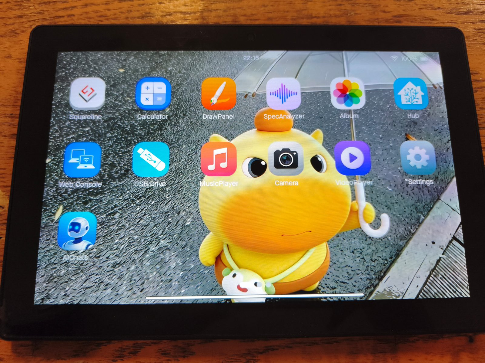
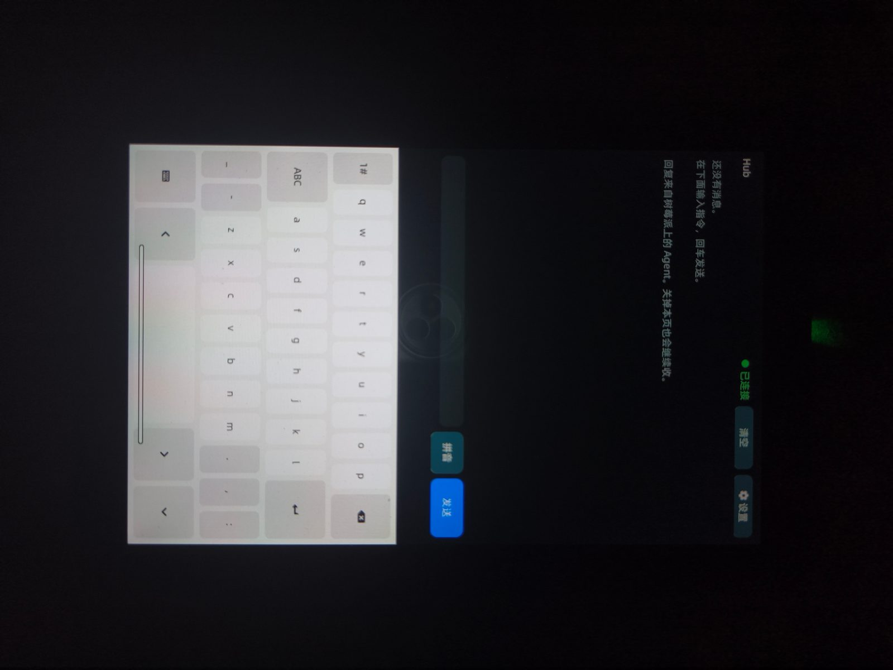
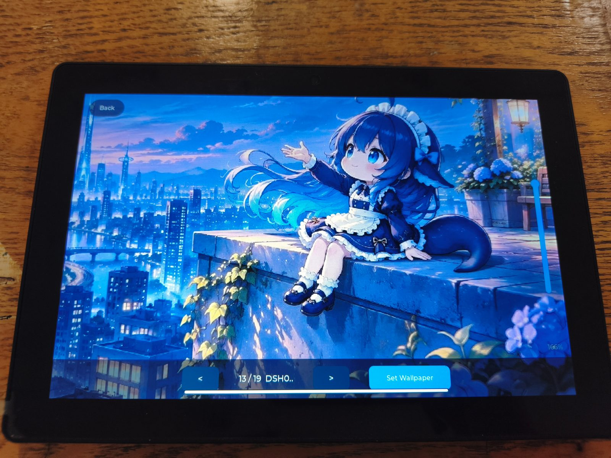
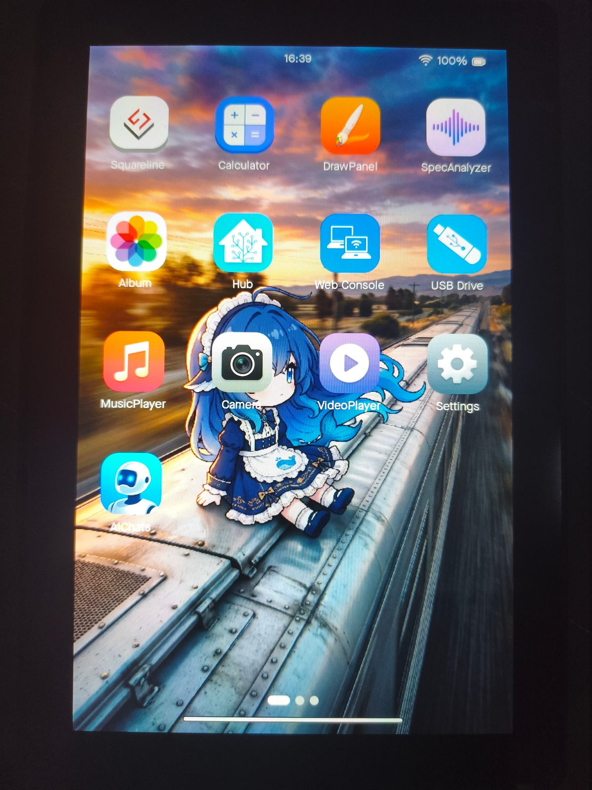
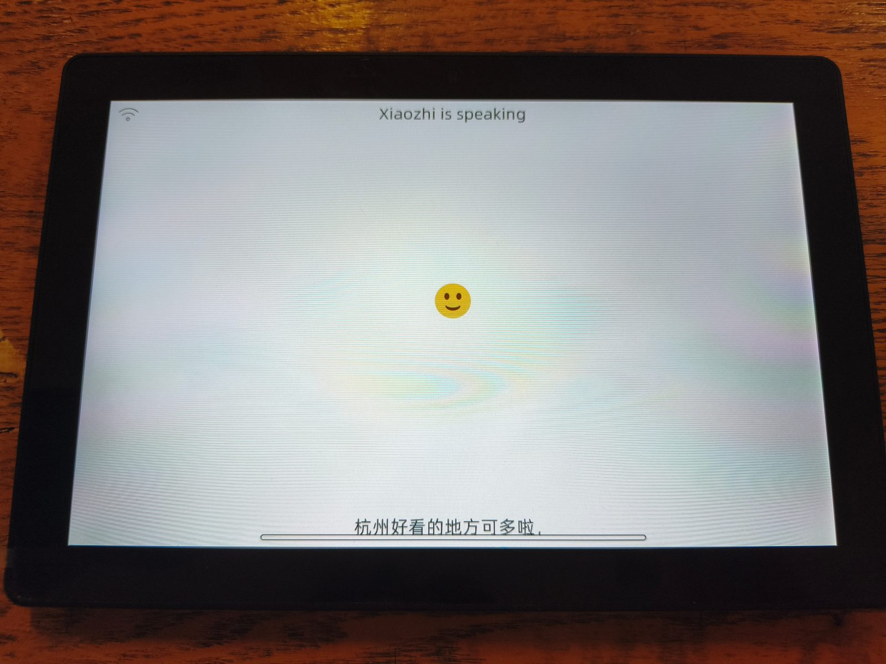
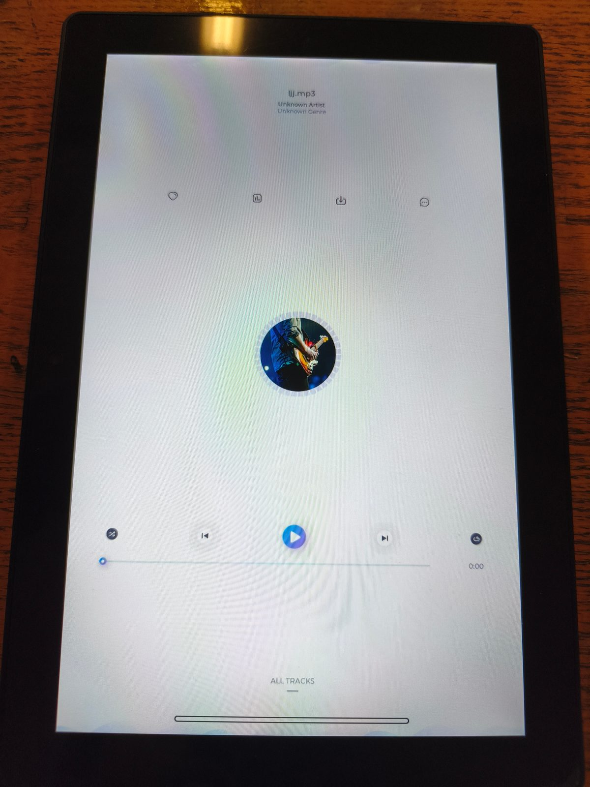
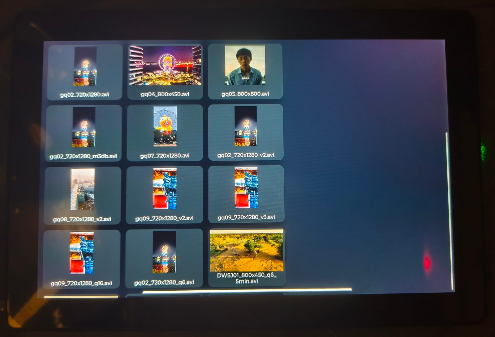
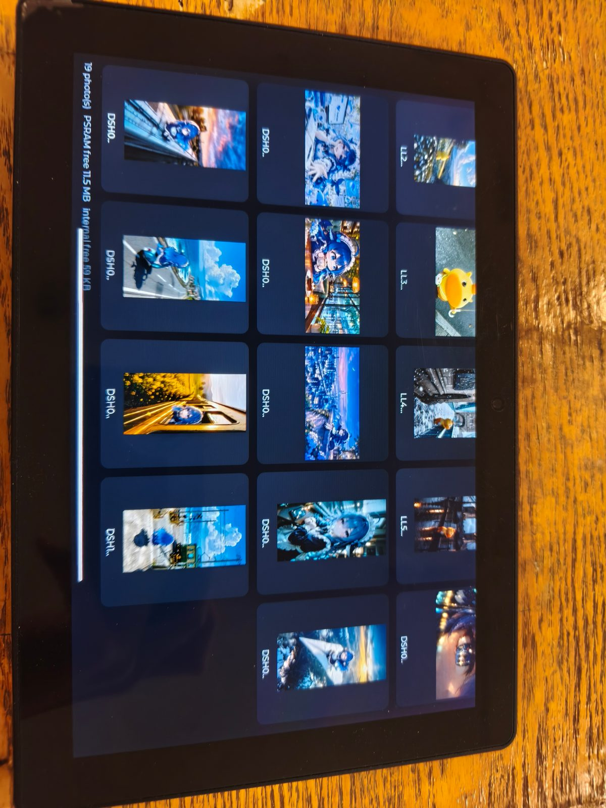
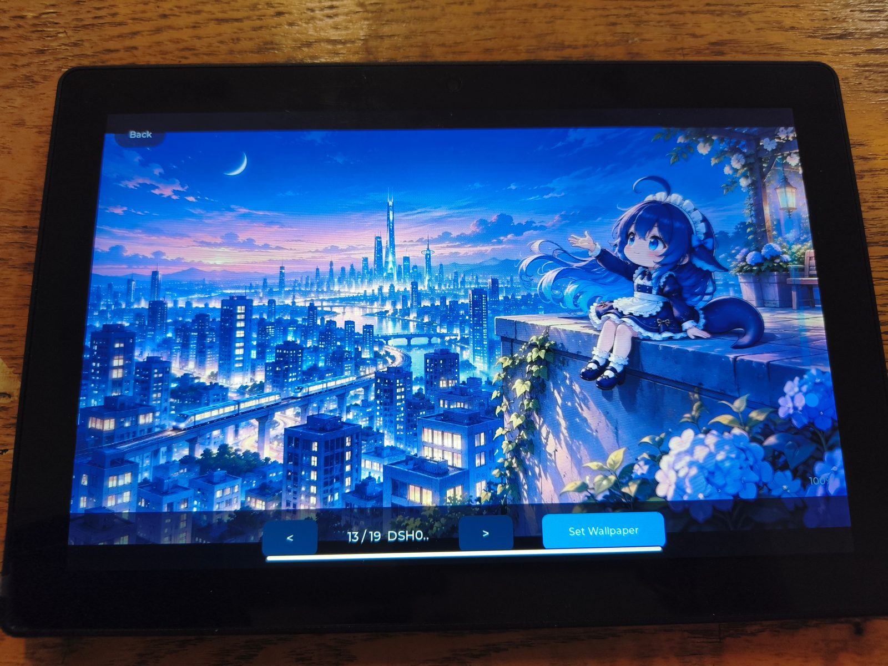
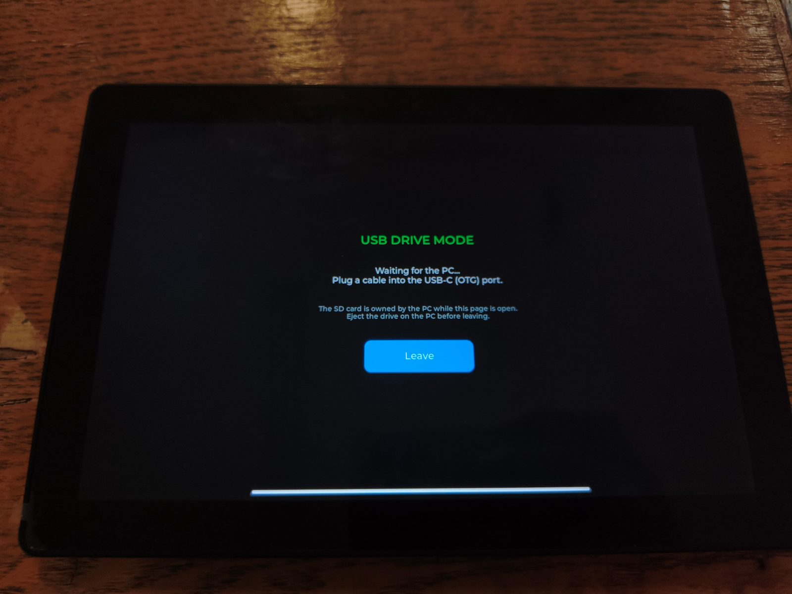

# Agent-Ops-P4-Terminal

**一台能听懂指令、也能被 Agent 驱动的触控终端 —— ESP32-P4 固件。**

🔗 **三件套** · [🔭 总蓝图](https://github.com/Ly-Systems-Lab/Agent-Ops-Architecture) · [🧠 控制面 · WeCom-Bridge](https://github.com/Ly-Systems-Lab/Agent-Ops-WeCom-Bridge) · [🔌 数据面 · Edge-Hub](https://github.com/Ly-Systems-Lab/Agent-Ops-Edge-Hub)

本仓是基于 **Agent-Ops 架构（三件套）**的 **🖥️ 端侧终端**：一台 10.1 英寸的 ESP32-P4 触控平板。

- **向上**：Hub 把用户敲的指令经 MQTT 交给 Agent，流式回执逐帧显示在屏幕上；
- **向下**：Agent 也能反向驱动它 —— 打开音乐、打开小智、一键清后台。

> 这套架构为什么这样分层、几个仓怎么配合 —— 见[总蓝图](https://github.com/Ly-Systems-Lab/Agent-Ops-Architecture)。
> 本仓只讲设备本身。（「Agent-Ops」与 `agentops.ai` 的观测平台无关。）

---

## 它能做什么

微雪 **ESP32-P4-WIFI6-Touch-LCD-10.1**（SKU 33672）出厂固件（ESP-Brookesia 手机风格桌面）的二次开发。
保留出厂的桌面与应用框架，在此之上加了自己的应用与服务：

| | |
|---|---|
| 🖼️ **桌面** | 应用网格、横屏 1280×800、可翻转 180°、壁纸（JPEG / WebP） |
| 📷 **相机** | 实时预览与拍照 |
| 🖼️ **相册** | JPEG / WebP；缩略图网格 → 1:1 明细图 → 缩放查看 |
| 🎬 **视频** | MJPEG/AVI 播放，硬件 JPEG 解码 + PPA 缩放旋转，横竖屏切换 |
| 🎵 **音乐** | MP3 播放，可从 SD 卡读取，支持后台播放 |
| ✏️ **画板 / 频谱分析 / 计算器** | 出厂示例应用 |
| 🌐 **网页控制台** | 板子起 httpd，浏览器里管理文件、看设备状态 |
| 💾 **U 盘模式** | 把 SD 卡通过 USB 交给电脑（MSC） |
| ⚙️ **设置** | WLAN、显示方向、音量、亮度等，NVS 持久化 |
| 🗣️ **小智 AI** | 语音对话（走小智官方云，需要联网） |
| 💬 **Hub** | **对 Agent 下指令、看流式回执** —— 本仓与 Agent-Ops 的接点 |
| 🤖 **MQTT 反控** | Agent 可以远程打开音乐 / 打开小智 / 一键清后台 —— 本仓与 Agent-Ops 的接点 |

WiFi 开机自动连接、断线自愈；网络配置与 broker 参数都存在设备 NVS 里。

---

## 实物与演示

### 实机照片

| 横屏桌面 | Hub | 相册 · 明细图 |
|:--:|:--:|:--:|
| [](docs/images/home-landscape.jpg) | [](docs/images/hub.jpg) | [](docs/images/album-zoom.jpg) |
| 应用网格，1280×800，可翻转 180° | 把指令发给 Agent，流式回执逐帧回来 | 点开按 1:1 解码，这张放大到 166% |

<details>
<summary>展开其余 7 张：竖屏桌面 · 小智 · 音乐 · 视频 · 相册网格 · 相册大图 · U 盘模式</summary>

| 竖屏桌面 | 小智 AI | 音乐 | 视频 |
|:--:|:--:|:--:|:--:|
| [](docs/images/home-portrait.jpg) | [](docs/images/xiaozhi.jpg) | [](docs/images/music.jpg) | [](docs/images/video-grid.jpg) |
| 同一个桌面，竖屏布局 | 语音对话，走小智官方云 | MP3 播放，可后台 | 先挑片：网格预览 |

| 相册 · 缩略图网格 | 相册 · 明细图 100% | U 盘模式 |
|:--:|:--:|:--:|
| [](docs/images/album-grid.jpg) | [](docs/images/album-photo.jpg) | [](docs/images/usb-drive.jpg) |
| 占位格先顶上，补图在后台一张张来 | 缩放条 100%–200% | 把 SD 卡交给电脑（MSC） |

</details>

> 屏显壁纸与视频封面是演示素材。

### 演示视频

[](https://www.bilibili.com/video/BV1TyyjzWEXU)

**[万物皆可调度！手搓一套架构，让 P4 平板指挥电脑和小车](https://www.bilibili.com/video/BV1TyyjzWEXU)** · 3 分 49 秒

视频里演示了两条链路：① 对着平板说话，小智 AI 充当中转，把话交给跑在电脑上的 Agent（DSH）；
② Agent 反过来通过 MQTT 调度物理世界 —— 拉起平板上的应用，让树莓派小车原地转一圈。
语音只做闲聊和轻量调度；高风险的物理动作要走控制面的审批卡片。

---

## 硬件

| 项 | 要求 |
|---|---|
| 板卡 | 微雪 ESP32-P4-WIFI6-Touch-LCD-**10.1**（P4 Rev3.x） |
| Flash | 32 MB（本仓分区表用到 32 MB） |
| PSRAM | 板载（Hex 模式，250 MHz） |
| 存储 | microSD 卡（音乐、视频、相册、壁纸放这里） |
| 工具 | ESP-IDF **v5.5.5** |

> 上游固件同时支持 7 英寸与 8 英寸版本；本仓保留了三者的 `sdkconfig.defaults.lcd-*`，
> 但**只在 10.1 英寸板上验证过**。

---

## 快速开始

### A. 直接刷预编译固件

到本仓的 [Releases](../../releases) 下载固件包并解压，然后：

```bash
pip install esptool
esptool.py --chip esp32p4 -p <PORT> -b 460800 write_flash @flash_args
```

固件包里的六个分段（`flash_args` 就是这张表）：

| 地址 | 文件 | 作用 |
|---|---|---|
| `0x2000` | `bootloader.bin` | 引导 |
| `0x8000` | `partition-table.bin` | 分区表 |
| `0x10d000` | `ota_data_initial.bin` | OTA 元数据 |
| `0x110000` | `srmodels.bin` | 语音唤醒模型 |
| `0x200000` | `esp32-p4-lcd-x-brookesia.bin` | **应用** |
| `0xa00000` | `storage.bin` | 出厂 SPIFFS 内容 |

后续只升级应用时，只写 `0x200000` 那一段即可。

### B. 自己编译

```bash
git clone https://github.com/Ly-Systems-Lab/Agent-Ops-P4-Terminal.git
cd Agent-Ops-P4-Terminal
. $IDF_PATH/export.sh          # ESP-IDF v5.5.5

idf.py -B build-lcd-10-1 \
  -D SDKCONFIG="$PWD/build-lcd-10-1/sdkconfig" \
  -D SDKCONFIG_DEFAULTS="sdkconfig.defaults;sdkconfig.defaults.rev3_x;sdkconfig.defaults.lcd-10-1" \
  build flash monitor
```

首次构建时，ESP-IDF 组件管理器会按各 `idf_component.yml` 自动拉取依赖组件（约 50 个）。

<details>
<summary>只要一个整片镜像？</summary>

```bash
cd build-lcd-10-1
python -m esptool --chip esp32p4 merge_bin -o merged.bin @flash_args
```

得到的文件从 `0x0` 开始整片写入。
</details>

---

## Hub 与 MQTT

Hub 是桌面上那个对话应用。它在屏幕上显示一条对话流，把用户敲的指令经 MQTT 发给树莓派上的 Agent，
再把流式回执逐帧显示出来。同一个连接上，Agent 还能反向给设备发命令。

主题、报文格式、错误码、反控命令的完整契约见 **[`docs/mqtt-contract.md`](docs/mqtt-contract.md)**。

反控方向本仓只演示三条命令（放音乐 / 开小智 / 一键清后台），用来跑通最小闭环；
这不是协议上限 —— 命令表就是设备侧一个分派函数，加一条自己的命令不用碰主题和报文格式（见契约 §11.5）。

**没有证书也能用**：`secrets/` 为空时构建照常通过，Hub 顶栏显示「缺证书」，只是不发起 MQTT 连接。
证书的生成方式见 [`secrets/README.md`](secrets/README.md)。

---

## 目录结构

```
components/
  brookesia_core/              桌面与应用框架（源自 ESP-Brookesia，已修改）
  esp32_p4_wifi6_touch_lcd_x/  板级支持包（源自微雪出厂固件源码，已修改）
  bsp_extra/                   音频 / 显示 / SD 等外设封装
  brookesia_app_album/         相册（JPEG / WebP、壁纸）
  brookesia_app_chat/          Hub（对话 UI + MQTT 传输）
  brookesia_hub_service/       MQTT 服务、证书嵌入、连接参数
  brookesia_hub_commands/      Agent 反控命令
  brookesia_net/               开机自连 WiFi 与自愈
  brookesia_web_console/       网页控制台后端
  brookesia_usb_storage/       USB MSC
  libwebp/                     Google libwebp 解码器（vendored）
main/                          应用装配与开机流程
local_components/              本地覆写的托管组件
spiffs/                        出厂 SPIFFS 内容（小智提示音）
secrets/                       MQTT 客户端证书（不入库）
docs/
```

> 上游组件自带的文档配图（`components/brookesia_core/docs/`、`systems/*/docs/`）未包含在本仓 ——
> 它们只服务于上游自己的文档，不参与编译。需要的话从上游仓库获取。

---

## 已知限制

- **视频只支持 MJPEG 编码的 AVI。** P4 有 H.264 **编码器**、没有解码器；单个 AVI 文件不要超过 1 GB
  （播放器只读第一个 `movi` 块，超了会在大约 15 分钟处直接结束）。
- **板子内置字体没有 emoji 字形**，显示到屏幕上的文本建议只用 ASCII；Hub 自带 20 px 中文字库。
- **拼音输入只能逐字选**，没有词组联想。
- **语音输入依赖小智官方云**；端侧只有唤醒词与命令词，没有自由 ASR。
- **反控命令本仓只演示三条**（`music` / `aichat` / `close_all`）。这是一套演示用的最小集，
  不是协议限制 ——「打开任意应用 / 点任意按钮 / 调音量」都可以自己做，
  见 [MQTT 契约 §11.5](docs/mqtt-contract.md#115-加自己的命令)。

---

## 许可

本仓以 **Apache License 2.0** 发布，见 [`LICENSE`](LICENSE)。
第三方组件的许可与逐条说明见 [`THIRD-PARTY-LICENSES.md`](THIRD-PARTY-LICENSES.md)。

本项目与 Espressif、微雪（Waveshare）均无从属关系，也不是任何一方的官方固件。